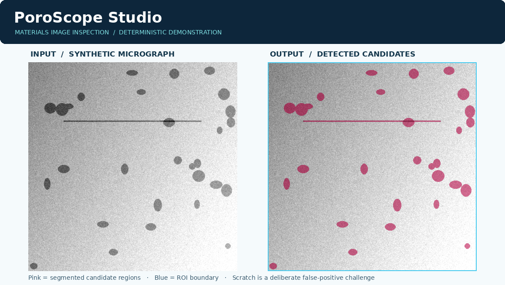

# PoroScope Studio

**Open, independent material-micrograph inspection and evidence reporting.**

[Inspect images](#start-in-under-five-minutes) · [Validation](docs/VALIDATION.md) · [Methods](docs/METHODS.md) · [Environmental context](docs/SUSTAINABILITY.md) · [Deployment](docs/DEPLOYMENT.md)

PoroScope Studio is an engineering application, **not a formula calculator**. It processes optical material images to propose candidate pores and second-phase regions, visualises the inspected field, measures 2-D properties, benchmarks processing against deterministic ground-truth images, compares batches and exports reproducible inspection evidence.



*Actual reproducible output from the included algorithm, using an explicitly synthetic specimen (not a photograph of real material).*

> **Scientific boundary:** a segmented dark or bright patch is not confirmed physical porosity. Area fraction measured on one micrograph is **not** an established 3-D porosity fraction; this project does not certify material safety or implement an acceptance standard. It is a reproducible preliminary research and image-screening tool.

## New in v1.1 — real aluminium-alloy microscope case

The **6061-T6 case study** adds a sourced, real experimental optical micrograph (Bob Clemintime, CC BY-SA 4.0), file checksum verification, image-area cropping to remove scale-bar annotations, three-algorithm comparison, threshold sensitivity, and attributed evidence ZIP export. The dataset has **no independently reviewed pixel ground truth**, so algorithm agreement **must not** be presented as real material defect detection accuracy. See [full case-study methods and image rights](docs/ALLOY_CASE_STUDY.md). The original image is fetched from its documented Wikimedia Commons source when requested; users can upload the original PNG if remote fetching is unavailable.

## What the project does

| Workspace | Demonstrated capability |
|---|---|
| **Overview** | Shows the processing pipeline and a labelled synthetic example |
| **Inspect** | Upload micrographs or generate a repeatable sample, choose one of four algorithms, modify detection parameters and view image overlays, connected regions and size distributions |
| **Batch lab** | Compare up to eight uploads with the *same* settings; mark cases for manual review against a user-defined image area marker |
| **Validation** | Independently recompute 12 synthetic-mask benchmarks with precision, recall, Dice, IoU and a deliberately difficult scratch scenario |
| **6061-T6 case study** | Check source provenance and run a real alloy micrograph across three segmentation methods, explicitly *without* claiming expert ground truth |
| **Materials & circularity** | Compare quality-inspection cautions for material families and understand sourced aluminium production/recycling energy context without claiming component-level carbon savings |
| **Report export** | PDF report plus a complete ZIP with normalized source PNG, overlay, binary mask, candidate CSV and reproducibility JSON with SHA-256 image checksum |

## Five completed engineering tasks

1. **Task 1 — Architecture:** separate deterministic analysis package, user interface, demo data, documentation and CI.
2. **Task 2 — Inspection engine:** lighting-corrected Otsu, standard Otsu, adaptive/local and manual thresholds; pixel-area filters, ROI, calibration, visual overlay and geometric outputs.
3. **Task 3 — Independent checks:** pixel-exact synthetic ground-truth masks, 12-case benchmark, defect/artifact stress test, deterministic seeds, error-handling tests.
4. **Task 4 — Material and circular design:** provenance-rich exports, explicit limits, vetted aluminium energy context, guidance on materials and waste-avoiding workflows.
5. **Task 5 — Production readiness:** automated GitHub Actions tests, `.gitignore`, 2 Python-version CI matrix, constrained dependencies, Windows launcher, Streamlit configuration, mobile-oriented layout and release checklists.

## Start in under five minutes

**Requirements:** Python 3.11 or 3.12 is recommended, internet access for the initial package install, and Windows, macOS or Linux.

**Windows — easiest:** extract the ZIP, then double-click `START_HERE_Windows.bat`. The script checks Python, installs dependencies and starts the app. Keep the command window open while using the website.

**Any operating system — terminal:** open a terminal in this extracted folder and run these commands, one at a time:

```bash
python -m pip install -r requirements.txt
python -m streamlit run app.py
```

If your terminal does not recognise `python`, use `py -3` on Windows or `python3` on macOS/Linux. Streamlit will give you a local address (usually `http://localhost:8501`). On Windows, do not copy the `\` prompts or `C:\Users\...` from screenshots into commands.

### Quick demonstration

1. Choose **Inspect** from the sidebar.
2. Keep **Synthetic demonstration**, select **Moderate | clear contrast** and seed `11`.
3. Inspect pink candidates, compare them with the exact reference mask and read the 2-D metrics.
4. Adjust the threshold and see how sensitive the result is.
5. Download **complete analysis ZIP**. Open `inspection_report.pdf`, `metadata.json` and `regions.csv` inside it.
6. Open **Validation** to check all 12 benchmark cases; open **Batch lab** to compare different conditions.

## Evidence and scores

Fixed reference benchmark: four scenarios × seeds 11, 21 and 31. The deliberately challenging case includes *non-pore scratches*, so false positives are observable. On the version included here, the mean pixel Dice is approximately **0.989**, and the smallest observed Dice is approximately **0.956** on synthetic reference images. These figures **do not estimate real-world predictive accuracy**. Re-run via:

```bash
python scripts/reproduce_validation.py
```

Complete methods, expected benchmark tables, limitations and independent real-image study proposals: [docs/VALIDATION.md](docs/VALIDATION.md).

Run unit tests and coverage:

```bash
python -m pip install -r requirements-dev.txt
python -m pytest -q --cov=poroscope --cov-report=term-missing --cov-fail-under=80
python scripts/check_independence.py
```

The repository includes an actual [GitHub Actions workflow](.github/workflows/ci.yml), triggered by pushes and pull requests and testing Python 3.11 and 3.12. Its runs begin when you publish the repository to GitHub.

## Data and provenance

- **No proprietary dataset is included.** Demo images are generated by the project's own reproducible code, not sourced from human subjects or described as real micrographs.
- The **original normalized image PNG** inside each report bundle is SHA-256 hashed. The JSON manifest records algorithm, sensitivity, scaling, and ROI settings. Input files are processed in app memory, with no file-writing feature in the web app.
- Uploaded TIFF, BMP, WEBP, PNG and JPEG images are converted to RGB before analysis; high-bit-depth scientific TIFF data are reduced to 8-bit. For scientific work, preserve the original image and document how it was prepared.
- The image itself is not accompanied by an inferred material grade, manufacturing method or safety evaluation.
- The optional `microns per pixel` setting must come from an **independent verified calibration**. Otherwise only pixel units are shown.

## Engineering pipeline

```text
Image / deterministic demo
     │
Validate format, dimensions and grayscale conversion
     │
Optional median denoising → central region-of-interest
     │
Otsu / flat-field Otsu / adaptive / manual segmentation
     │
Connected components → reject small/border-touching candidates
     │
2-D count, area fraction, equivalent diameter and morphology
     │
Threshold-parameter sensitivity (NOT a confidence interval)
     │
Overlay + batch review + report PDF / auditable ZIP
```

### Why this method?

It is transparent, low-cost and easily reproducible without requiring a trained neural network. It is also sensitive to illumination, etching, scratches, resolution and material differences; these limits are measured where possible and documented rather than hidden.

### Repository structure

```text
PoroScope-Studio/
├── app.py
├── poroscope/
│   ├── alloy_case.py       # Verified real-image case, comparisons, attributed exports
│   ├── engine.py           # Segmentation, image measurements, sensitivity
│   ├── synthetic.py        # Reproducible test images and pixel-exact masks
│   ├── validation.py       # Pixel benchmarking
│   ├── reporting.py        # PDF, CSV, JSON, PNG and evidence ZIP
│   ├── io.py               # Safe image decoding and limits
│   └── circularity.py      # Material pathways and sourced context
├── docs/ALLOY_CASE_STUDY.md # Real image provenance and interpretation
├── assets/demos/           # Four demo images, truth masks, annotated preview
├── tests/                  # Core, benchmark and reporting regression tests
├── scripts/                # Reproduction and independence checks
├── docs/                   # Methods, validation, deployment, sustainability
├── .github/workflows/ci.yml
├── .streamlit/config.toml
├── requirements.txt
├── requirements-dev.txt
├── pyproject.toml
├── START_HERE_Windows.bat
└── LICENSE                 # BSD 3-Clause, no institutional affiliation
```

## Scientific evidence status

The image-sourced 6061-T6 case establishes that the algorithms can be challenged with **real unlabelled microscopy**, not that they can identify pores correctly. It is an exploratory method-robustness case. For claim-level external validation, collect representative real specimens and independent expert-labelled image masks. **No real-image detection accuracy is claimed.**

## Limitations and future scientific work

Potential candidates can include oxides, inclusions, polishing marks, shading, surface contamination and segmentation errors. One image does not establish internal defects. Region count can change when objects overlap. The synthetic demo intentionally omits many real-world sources of variability. Before applying this to a real manufacturing decision, arrange microscopy protocol, multi-operator labelling, validated calibration, representative labelled samples, measurement system analysis and independent examination using an appropriate qualified method.

**Software quality ≠ verified material quality.** This project focuses on being defensible as an engineering portfolio demonstration, not on claiming certification or perfect accuracy.

## Project licence

BSD 3-Clause. See [LICENSE](LICENSE). This is a standard open-source software licence, not a link to a university or institution.

## Author and contribution

Independent engineering research application. Issues and pull requests are welcome after publishing the repository. External input image datasets are not redistributed by this project.
